  <picture>
    <source media="(prefers-color-scheme: dark)" srcset="header-dark.svg" />
    
  </picture>

Hi, I'm Alexey. I'm co-founder and solution architect at Utopy AI, a platform for generating images and video. Before that I was a system architect at Quadcode, a fintech trading company, and CTO at a couple of smaller ones. I've been on GitHub since 2009, early enough to get a six-digit user id.

Utopy itself is closed source. What's open is below: two projects, and the small libraries I pulled out of production services after writing the same code for the third time.

## Projects

**[weeek-mcp](https://github.com/adalekin/weeek-mcp)** &nbsp;

An MCP server for the [Weeek](https://weeek.net) tracker: 40+ tools covering tasks, boards, comments, time tracking and the knowledge base. Weeek has no public API for the knowledge base, so the server uses the internal one, and edits document bodies over Weeek's collaborative channel (Hocuspocus/Yjs). It installs into Claude Desktop from one `.mcpb` file.

**[zrs](https://github.com/adalekin/zrs)** &nbsp;

Self-hosted expense requests: an employee asks for money, a moderator approves, someone pays, and every decision stays in the log. The server is FastAPI on PostgreSQL, the UI is Nuxt, and login goes through any OpenID Connect provider. It ships as Docker images and a Helm chart.

## The approck toolkit

These are the pieces I reuse across FastAPI services. All of them are on PyPI.

| Package | What it does |
|---|---|
| [approck-services](https://github.com/adalekin/approck-services) | Generic async service layer for SQLAlchemy and FastAPI, so CRUD is one line per model |
| [approck-sqlalchemy-utils](https://github.com/adalekin/approck-sqlalchemy-utils) | Async and sync sessions in one step, a FastAPI dependency, base model, Alembic helpers |
| [approck-sqlalchemy-query-builder](https://github.com/adalekin/approck-sqlalchemy-query-builder) | Turns a JSON filter tree into a SQLAlchemy `WHERE` without letting raw JSON near the database |
| [approck-fastapi-utils](https://github.com/adalekin/approck-fastapi-utils) | JWT payloads from headers, uniform JSON responses, exception handlers |
| [approck-messaging](https://github.com/adalekin/approck-messaging) | Message contract between backends and Telegram bots over Redis streams |
| [approck-aiogram-utils](https://github.com/adalekin/approck-aiogram-utils) | The aiogram side of that contract |

## Smaller things

- [pytest-clickhouse-mock](https://github.com/adalekin/pytest-clickhouse-mock): test ClickHouse code without running ClickHouse
- [wsgiref-fake](https://github.com/adalekin/wsgiref-fake): exercise a WSGI app in-process without binding a port
- [gevent-toolbelt](https://github.com/adalekin/gevent-toolbelt): graceful shutdown and cooperative services for gevent

## Stack

  

## Say hi

Bug reports and pull requests are the fastest way to reach me. For everything else there's [LinkedIn](https://www.linkedin.com/in/adalekin) and [adalekin@gmail.com](mailto:adalekin@gmail.com).
